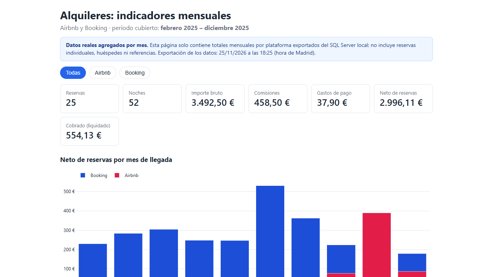

<div align="center">


# Plataforma local de analítica

Pipeline local que importa hojas de cálculo de alquileres a SQL Server con n8n y presenta los indicadores mensuales en un dashboard de Dash, con una versión pública en GitHub Pages.

[](https://juliouq.github.io/plataforma-analitica-local/)

    



<sub>Demo pública: agregados mensuales reales, sin reservas individuales.</sub>

</div>

---

## Descripción general

Automatiza el seguimiento de alquileres de Airbnb y Booking. Los Excel exportados de cada plataforma se dejan en una carpeta; n8n los importa cada día a SQL Server y un dashboard en Dash calcula los indicadores mensuales por plataforma y periodo.

La página pública solo publica agregados mensuales exportados a JSON: los Excel y los datos individuales se quedan en el equipo.

## Funcionalidades

- **Importación diaria** con n8n a las 09:00 (Europe/Madrid), o manual con un script de PowerShell.
- **Modelo en SQL Server** con scripts versionados en `sql/`.
- **Dashboard local** en Dash con filtros por plataforma y periodo.
- **Publicación segura:** exportación de agregados a JSON y despliegue automático en GitHub Pages con GitHub Actions.
- **Demo reproducible** con datos ficticios desde un CSV.

## Tecnologías y herramientas

| Ámbito | Herramientas |
| --- | --- |
| Orquestación | n8n |
| Base de datos | SQL Server (T-SQL), Docker |
| Análisis y dashboard | Python, pandas, Dash |
| Publicación | GitHub Actions, GitHub Pages |

## Estructura del proyecto

```text
.
├── etl/n8n/          # Flujo de importación, scripts de carga y demo con datos ficticios
├── sql/              # Esquema y consultas de SQL Server
├── python/           # Dashboards, exportación de agregados y generación de la página
├── publicacion/      # agregados_alquileres.json (lo único que se publica)
├── .github/workflows/pages.yml
├── GUIA_OPERATIVA.md # Configuración de SQL Server, Docker, n8n y Python
└── requirements.txt
```

## Instalación y uso

Deja los Excel en `data/`. Para importar a mano y arrancar el dashboard, desde la raíz en PowerShell:

```powershell
.\etl\n8n\importar_alquileres.ps1
.\.venv\Scripts\python.exe python\dashboard_alquileres.py
```

Abre [Dash local](http://127.0.0.1:8060) para consultar los indicadores.

Para publicar cifras nuevas después de una importación:

```powershell
.\.venv\Scripts\python.exe python\exportar_agregados.py
git add publicacion/agregados_alquileres.json
git commit -m "Actualiza los agregados publicados"
git push
```

GitHub Actions reconstruye la página tras el push a `main`. La [guía operativa](GUIA_OPERATIVA.md) explica la instalación completa y la [demo con datos ficticios](etl/n8n/README.md) permite probar el flujo sin datos reales.

## Resultados

- [Caso de estudio en el portfolio](https://juliouq.github.io/Portfolio-Web---JulioUQ/es/casos/plataforma-analitica/): arquitectura, decisiones y límites del proyecto.

## Aspectos técnicos destacados

- Separación estricta entre datos privados (locales) y datos publicados (agregados).
- Pipeline completo: ingesta programada, base de datos relacional, análisis y publicación continua.

## Autor

**Julio Úbeda Quesada** · Data Scientist

[](https://juliouq.github.io/Portfolio-Web---JulioUQ/es/) [](https://www.linkedin.com/in/juliouq/) [](https://github.com/JulioUQ)
